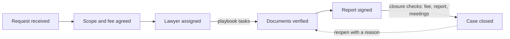

# Case management: requirements and design

1 Nov 2026 · Rajesh · Status: design agreed for build; implementation is in PR #20 (not merged yet)

To build it step by step, follow the [build guide](build-guide.md).

## Summary

Every Homexo ticket becomes a managed case: it moves through six milestones from request to signed report, has an owner and a case team, a task list, deadlines that show when they slip, a fee that is quoted and collected, and a closure step that will not close a case while work is still owed.

The case is the existing ticket (`service_requests`), not a new record. Intake, ticketing, bookings, documents, the verification checklist, LLM checks, meetings and payments already hang off the ticket, so the case layer adds what ties them together rather than rebuilding them.

This doc decides five things:

1. Six customer-facing milestones computed from facts (assignment, fee, checklist, report), not from the status field alone.
2. A transition map for statuses, with a gated close and an explicit reopen.
3. Case tasks, with a playbook that creates and ticks off routine tasks by itself.
4. Two deadlines per case: first response and case due date, plus a board that shows what is late.
5. A case fee: quoted, then paid or waived, recorded on the case.

## What already exists

Most case work is already built on main; what is missing is the layer that says where a case stands, who owes what next, and when it is done.

| Area | On main today | Gap the case layer fills |
| --- | --- | --- |
| Intake | Callback form, chat, app and online booking raise a ticket with property details and a document request | No scope or fee confirmation step |
| Ticketing | 13 statuses, priority, urgent alerts, messages, internal notes, activity log, queue with filters | Any status can jump to any other; closed tickets can be edited back without a record of why |
| Lawyer assignment | One case owner per ticket (admins assign); report has a lawyer and a reviewer | No case team; agents only see tickets they own |
| Documents and verification | Tagged uploads, preliminary report checklist, government fetch queue, Claude checks on each upload, evidence-based verification agent | Progress is not rolled up into one view of the case |
| Meetings | Google Meet consults with WhatsApp invites and reminders | None |
| Payments | Razorpay for consultation bookings only | No fee for the legal work itself |
| Reports | Final PDF generated, printed, signed and uploaded | Signing does not move the case on |
| Status tracking | Customer tracking card and account page show status history | No plain view of the steps left |
| Closure | Staff set Completed | No checks, no outcome, no reopen rule |
| Deadlines | `due_at` column exists but is unused; service types carry a turnaround | No first-response target, no overdue view |

## Requirements

### Who uses it

| Actor | What they need from the case system |
| --- | --- |
| Customer (buyer, owner, developer) | See the steps left, what they must do next, the fee, and the report when it is ready |
| Case owner (lawyer or agent) | One page per case with tasks, deadlines and blockers; a list of their own tasks across cases |
| Case team member (associate, paralegal, reviewer) | Open the cases they help on and pick up tasks assigned to them |
| Admin | A board of every open case by milestone, what is late, who is overloaded, and the power to override a closure check |

### Functional requirements

**Lifecycle**

- CM-1. A case shows six milestones: Request received, Scope and fee agreed, Lawyer assigned, Documents verified, Report signed, Case closed. Each is done or not based on facts in the case.
- CM-2. Staff can only move a case along allowed transitions. A closed case can only be reopened, with a reason.
- CM-3. Closing as Completed runs closure checks. Blockers: an unpaid quoted fee, a report started but not signed, a meeting still scheduled. An admin can close anyway with a written reason, which is logged.
- CM-4. Every close records an outcome (delivered, withdrawn by customer, not viable, duplicate, other) and an optional summary. Open tasks are cancelled on close.

**Team and assignment**

- CM-5. A case has one owner (today's assignment) and any number of team members with a role: associate, paralegal, reviewer.
- CM-6. Agents see cases they own or are a team member on. Admins see all.

**Tasks**

- CM-7. Staff add tasks to a case with a title, optional notes, an assignee from the team, and a due date; they tick them done or cancel them.
- CM-8. A playbook adds routine tasks when a milestone is reached (confirm scope, issue the preliminary report, chase documents, sign the final report) and ticks them done when the system sees the work happen.
- CM-9. Each staff member has a My tasks list across cases, overdue first.

**Deadlines**

- CM-10. First response is due 4 hours after the request (`CASE_FIRST_RESPONSE_HOURS`). It is met by the first staff message to the customer, status change or assignment.
- CM-11. The case due date is set from the service's turnaround (7 days if none). Staff can move it with a reason.
- CM-12. Overdue cases, overdue tasks and missed first responses show on the board and the queue.

**Fee**

- CM-13. Staff quote a fee for the case. The customer sees it on their tracking card and account.
- CM-14. Staff record the payment (UPI, bank transfer, cash, card, with a reference) or waive the fee with a reason. Online payment of case fees through Razorpay is phase 2.

**Visibility**

- CM-15. The customer tracking card and account page show the milestones, the next thing the customer must do, the due date and the fee.
- CM-16. Staff get a case board: open cases in milestone columns, with overdue, urgent and open-task markers, plus counts for open, overdue, due this week and closed in the last 30 days.
- CM-17. Every case action is in the activity log and the audit log.

### Non-functional requirements

- Works with the existing stack: FastAPI, SQLAlchemy, Alembic, Next.js admin, SQLite in tests and PostgreSQL in production.
- No breaking change to existing APIs; new fields are added to existing responses.
- Customers never see internal tasks, team phone numbers or override reasons.
- Board and task queries stay under 300 ms for 5,000 open cases (indexed by status, due date and assignee).
- New admin screens use the existing admin styles and shared colour tokens, so the Homexo UI restyle (`docs/design/homexo-ui/`) can restyle them with the rest.

## Design

### Data model

One migration, `0014_case_management`, adds two tables and 11 columns on `service_requests`. Nothing existing is renamed or dropped.

| Table or column | Purpose |
| --- | --- |
| `case_tasks` | id, case, title, notes, assignee, due_at, status (open, done, cancelled), source (manual, playbook), playbook_key, created_by, completed_by, completed_at |
| `case_members` | case, staff user, role (associate, paralegal, reviewer), added_by, added_at, removed_at |
| `service_requests.first_response_due_at`, `first_response_at` | First-response deadline and when it was met |
| `service_requests.due_at` (exists) | Case due date, now filled at creation |
| `closure_outcome`, `closure_summary`, `closed_at` | How and when the case closed |
| `fee_quote_paise`, `fee_status`, `fee_paid_paise`, `fee_reference`, `fee_paid_at`, `fee_note` | The case fee: none, quoted, paid or waived |

### Status transitions

Statuses stay the same 13 values so the queue, the app and the chat assistant keep working. The new rule is which moves staff may make. System moves (a booking confirmed, a document request answered) are not limited.

| From | Staff may move to |
| --- | --- |
| Any open status | Any other open status, On hold, Cancelled, Rejected |
| Any open status | Completed, after closure checks |
| On hold | Any open status, Cancelled |
| Completed, Cancelled, Rejected | Reopened only, with a reason |

### Milestones

The customer and staff see six milestones. Each is computed from facts on the case, so it cannot drift from the work.

| Milestone | Done when |
| --- | --- |
| Request received | Always |
| Scope and fee agreed | A fee is quoted, paid or waived, or the case passed Scope confirmed |
| Lawyer assigned | The case has an owner |
| Documents verified | The report checklist is issued and every item is verified or waived |
| Report signed | The signed final report is uploaded |
| Case closed | Status is Completed |

The current milestone is the first one not done. Cases with no report (for example a consultation booking) skip the two document milestones.

Work runs from request to close; the only way out of Case closed is a reopen with a reason.

### Playbook tasks

| Key | Created when | Due | Ticked done when |
| --- | --- | --- | --- |
| confirm-scope | Request received | First-response deadline | A fee is set or the case reaches Scope confirmed or later |
| issue-report | Lawyer assigned (cases that need documents) | 2 days | Preliminary report issued |
| chase-documents | Preliminary report issued | 5 days | Checklist complete |
| sign-report | Final report generated | 2 days | Signed report uploaded |

Playbook tasks go to the case owner and follow a reassignment while still open.

### Closure checks

`case_management.closure_check(case)` returns blockers and warnings. Blockers stop a Completed close unless an admin gives an override reason. Warnings are shown but do not stop it.

- Blocker: fee quoted but not paid or waived.
- Blocker: report started but not signed.
- Blocker: a meeting is still scheduled.
- Warning: open tasks, which are cancelled on close.

### API

| Endpoint | Does |
| --- | --- |
| `GET /admin/tickets/{n}` | Adds a `case` block: milestones, deadlines, team, tasks, fee, closure check, allowed next statuses |
| `PATCH /admin/tickets/{n}` | Enforces transitions; takes `outcome`, `closure_summary`, `override_reason`, `due_at`, `due_reason` |
| `POST /admin/tickets/{n}/tasks`, `PATCH .../tasks/{id}` | Add, edit, complete, cancel tasks |
| `POST /admin/tickets/{n}/members`, `DELETE .../members/{user}` | Add or remove team members (admin or owner) |
| `PUT /admin/tickets/{n}/fee` | Quote, record payment, or waive |
| `GET /admin/cases/board` | Open cases grouped by milestone, with markers and counts |
| `GET /admin/tasks` | My tasks (or anyone's, for admins), overdue first |
| Customer lookup, account request | Add `progress`: milestones, next step for the customer, due date, fee |

### Screens

- Staff ticket page: a Case panel at the top with the milestone bar, deadlines, fee and closure check; a Tasks card; a Case team card in the side column; Close and Reopen in the Status card, which ask for an outcome.
- New Case board page (`/admin/cases`): milestone columns of case cards, counts across the top, and a My tasks list.
- Customer tracking card and account request page: a six-step progress bar, the next thing to do, the due date and the fee.

## Rollout, open questions and scope

Phase 1 ships in one pull request for review before it reaches main. Existing cases get deadlines and playbook tasks the first time they change; nothing is back-filled in bulk.

1. Phase 1 (PR #20): migration, lifecycle rules, closure checks, tasks and playbook, team, deadlines, fee recording, case board, staff and customer screens, tests.
2. Phase 2: online payment of case fees through Razorpay (reusing the booking payment code), WhatsApp alerts for task assignment and overdue cases, case screens in the Android and iPhone app.
3. Phase 3: deadlines that pause while on hold or waiting for the customer, working-hours calendars, workload balancing when assigning, and reports on time to close by service.

**Open questions for Rajesh**

- [ ] Is 4 hours the right first-response target, and should it count only working hours (for example 9 am to 7 pm, Monday to Saturday)?
- [ ] Should a customer be able to ask to reopen a closed case themselves, or only by calling?
- [ ] Should agents be allowed to override closure checks, or only admins (the design says admins only)?
- [ ] Is GST shown separately on the case fee?

**Out of scope:** court case and hearing tracking, invoices and GST filing, time sheets and billing by the hour, and customer e-signatures.
