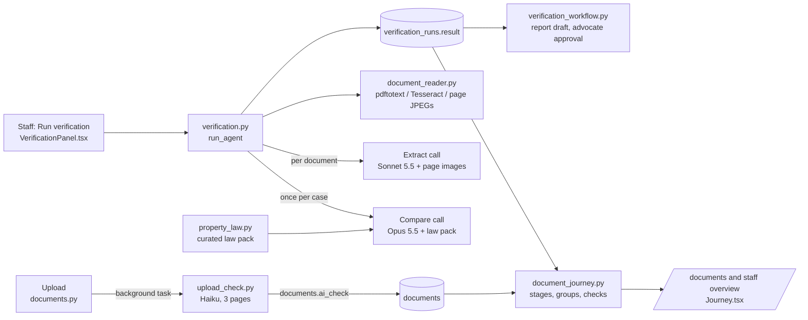
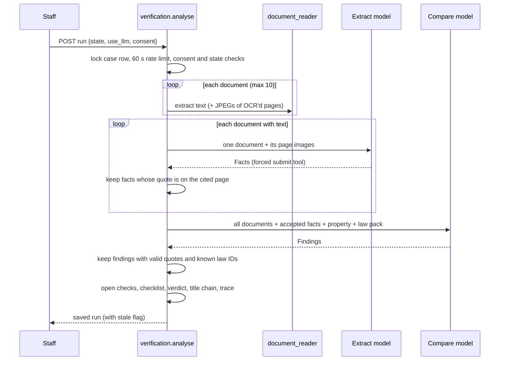

# LLM document verification: design

**Status:** design of the build on `main` (2026-10-31), with the planned accuracy work in section 9.
Requirements IDs (UC-, VR-, AW-, DJ-, NF-) refer to [requirements.md](requirements.md).

## 1. Principles

1. **The model reads; code decides.** The model extracts facts and proposes findings. Code validates every quote,
   applies date rules, computes the verdict and decides what is shown. Checklist statuses, report approval and
   signing stay with people.
2. **Every claim is quoted.** A fact or finding must point to a document, a page and literal text that exists in that
   page's extracted text. Page images help the model read; they are never the quote anchor.
3. **Fail closed, but not all-or-nothing.** A broken response discards the whole LLM step. A single unsupported quote
   discards only that item, and the discard is visible and blocks the most favourable verdict.
4. **Use the right model for each step.** Cheap and fast at upload, vision for reading scans, the strongest model
   where a missed defect is costly.
5. **Documents are untrusted input.** Text inside a deed is evidence, not instructions.

## 2. Components

| Module | Responsibility |
| --- | --- |
| `document_reader.py` | Bounded text extraction from PDF, image and DOCX; OCR for pages with under 50 characters of embedded text; JPEG copies of OCR'd pages for the vision model. |
| `upload_check.py` | Per-upload classification and quality check; deterministic EC rules; stores `documents.ai_check`. |
| `verification.py` | Provider transport (`model_call`), model selection, schemas, quote validation, the run pipeline, verdict, title chain, run history API. |
| `property_law.py` | Versioned, curated law principles (`LAW_VERSION`), 5 national and 2 Karnataka entries. |
| `verification_workflow.py` | Bridges a run to the advocate report: draft from run, approval gate, final-PDF gate. |
| `document_journey.py` | Customer/staff view of stages, document groups, links and checks, derived from existing data. |

## 3. Upload check flow (UC-1 to UC-11)

1. The upload endpoint stores the file and, if `upload_check.enabled()`, schedules `upload_check.run(document_id)` as a
   FastAPI background task. The response returns first.
2. `assess` reads up to 3 pages (text capped at 4,000 characters per page, plus JPEGs of scanned pages). A file with
   no text and no image is marked unreadable without a model call. Unsupported types are `skipped`.
3. One `classify` call (default `claude-haiku-5-5`, 60 s timeout) receives the filename, the tag it was filed under
   and the case's requested items plus all standard tags, and returns `UploadCheck` through the forced tool.
4. Code then sanitises: `suggested_tag` must be a known tag, dates must parse as ISO, and for ECs the 45-day and
   30-year rules add problems. Problems are de-duplicated and capped at 6.
5. The result (with model, time and file checksum) is stored in `documents.ai_check`. Any error stores
   `status: failed`.
6. `upload_check.view` builds what both audiences see and computes `tag_mismatch` at read time, so re-filing a
   document clears the flag without another call.

Design choice: the model reads the dates, the code applies the rule. Date arithmetic and "is this recent enough" are
exactly the things a model gets subtly wrong and code gets right.

## 4. Case verification run (VR-1 to VR-14)

### 4.1 Pipeline

### 4.2 Why per-document extraction

One call per document keeps each prompt small, lets the model see only that file's page images, and stops facts from
one deed being attributed to another (a fact whose `document_id` is not the document being read is rejected). The
comparison then sees every document's text and the accepted facts together, which is where contradictions show up.

### 4.3 Model selection

| Step | Default (Anthropic) | Why | Override |
| --- | --- | --- | --- |
| `classify` (upload check) | `claude-haiku-5-5` | Runs on every upload; a short, bounded task. | `VERIFICATION_CLASSIFY_MODEL` |
| `extract` (per document) | `claude-sonnet-5-5` | Needs vision for Kannada scans and EC tables; runs N times per case. | `VERIFICATION_EXTRACT_MODEL` |
| `compare` (per case) | `claude-opus-5-5` | One call per case where a missed defect is expensive. | `VERIFICATION_COMPARE_MODEL` |

`VERIFICATION_LLM_MODEL` sets one model for every step without a per-step override. For provider `openai` all
steps default to `gpt-4.1-mini`.

### 4.4 Structured output

Schemas are Pydantic models with `extra="forbid"`. With Anthropic, the schema (with `$ref`s inlined) is the input
schema of a single tool `submit`, and `tool_choice` forces it, so the provider enforces the shape. A response that
does not stop on `tool_use`/`end_turn`, or does not contain exactly one `submit` call, is an error. With an
OpenAI-compatible provider the schema is sent in the prompt with `response_format: json_object`, and
`finish_reason` must be `stop`. Output is capped at 16,000 tokens; timeout is 300 s (60 s for upload checks).

### 4.5 Grounding (quote validation)

`normalise()` applies Unicode NFC, removes soft hyphens and zero-width characters, joins words hyphenated across a line
break, collapses whitespace and case-folds. A quote is valid when its normalised form (at least 5 characters) is a
substring of the normalised text of the cited page of the cited document. The page text is what was extracted on this
run, so a quote can only point at evidence the reader actually produced.

This catches invented or paraphrased quotes. It does not prove the model's interpretation is right, which is why
findings still go to an advocate.

### 4.6 Verdict

Computed in this order:

| Condition | Verdict |
| --- | --- |
| Any accepted finding with severity `high` or `critical` | `high_risk` |
| Any extraction warning, no checklist, an open checklist item, an open intake question, LLM not completed, or any discarded fact/finding | `insufficient_evidence` |
| Otherwise | `conditional_review` (still needs independent searches and a signed opinion) |

`high_risk` wins even when evidence is incomplete, because a quoted serious defect is worth acting on immediately.

### 4.7 Title chain

The chain is built only from accepted facts. Documents are ordered only when each has exactly one valid ISO execution
date; the rest are listed as undated. Consecutive documents are linked as `name_match_only` when there is exactly one
buyer and one seller and the names match after whitespace/case normalisation, otherwise `unresolved`. No fuzzy name
matching is done, on purpose: a false link in a title chain is worse than a gap the advocate fills.

### 4.8 Staleness and history

The run stores `input_fingerprint`, a SHA-256 of document IDs/hashes/tags, property details, intake answers and
checklist items (status, notes, reviewer). Views recompute it, so a run becomes stale as soon as anything it depended on
changes. The draft and approval endpoints refuse stale runs.

## 5. Advocate workflow (AW-1 to AW-4)

The draft copies quoted findings, law references, chain facts, limitations and open checks into the existing editable
legal report and records an `agent_report` marker with an evidence fingerprint (documents, property, intake) and the
law pack version. Approval re-checks both, and requires the advocate's attestations and sources. Any change to
evidence or the law pack forces a fresh run and draft. Karnataka only, because the law pack's state entries are
Karnataka only.

## 6. Document journey (DJ-1 to DJ-5)

`document_journey.journey()` is pure presentation over existing data: checklist item statuses, report status, the
latest run's fingerprint (for the "documents read" stage) and `documents.ai_check` problems (as flags). It adds no
judgement of its own, so customers and staff can rely on it meaning the same thing. Groups follow the order a title
review builds on: identity feeds title, title feeds charges, records, approvals and searches, and everything feeds the
advocate's opinion.

## 7. Failure handling

| Failure | Effect |
| --- | --- |
| File missing or checksum mismatch | Warning on that file; it is not analysed; verdict cannot be conditional. |
| OCR tools/language packs missing, encrypted or corrupt file | Extraction warning; same as above. |
| Page/file/case text limit hit | Text cut, warning added. |
| Provider HTTP error, timeout, truncated or schema-invalid output | `llm_status: failed`, all model output dropped, `insufficient_evidence`, trace explains; provider body not logged. |
| One fact/finding with a bad quote or unknown law ID | That item dropped, counted in `rejected`, run kept. |
| Upload check error | `ai_check.status = failed`; upload unaffected; staff can check again. |

## 8. Security and privacy

- Keys come from server environment only (`VERIFICATION_LLM_API_KEY`, or `ANTHROPIC_API_KEY` for Anthropic); the
  analysis endpoint accepts no client-supplied URL or key. OpenAI-compatible base URLs must be HTTPS without credentials.
- Case runs need per-run staff consent. Upload checks send data whenever configured and can be switched off.
- Page images are passed in memory and never written to the saved run.
- Runs keep extracted text and evidence in the database and need the same access and retention controls as the files.
- The system prompt marks documents as untrusted; schema-forced output limits what injected text can change; quote
  validation stops invented evidence.

## 9. Planned design (accuracy work)

These follow the accuracy proposal agreed on 2026-10-31. Steps 1 and 2 of that proposal are built (PRs #14, #15).

1. **Code cross-checks (VR-15, DJ-6).** After extraction, compare facts across documents in code: survey/hissa number
   normalisation (`42/1` vs `42 / 1` vs `Sy. No. 42-1`), extent with unit conversion (acres, guntas, sq ft, sq m),
   owner name matching with initials and transliteration tolerance, and EC coverage across the chain's dates. Each
   mismatch becomes a deterministic finding with both quotes, and a flag on the matching journey check.
2. **Per-document-type schemas (VR-17).** Use the upload check's document type to pick a schema (sale deed: schedule,
   boundaries, consideration, registration number; EC: period and entries; RTC: survey, extent, khatedar), so the
   cross-checks compare like with like.
3. **RERA match (VR-16).** Match the project/promoter in the documents against `rera_projects` once real data is imported.
4. **Confidence and evaluation (VR-18, NF-11).** A gold set of 30 to 50 past cases with the advocate's outcome; measure
   fact precision/recall and finding recall per model before changing defaults.
5. **Background worker (NF-10).** Move the case run to a durable queue so scans do not hold an HTTP request open.
